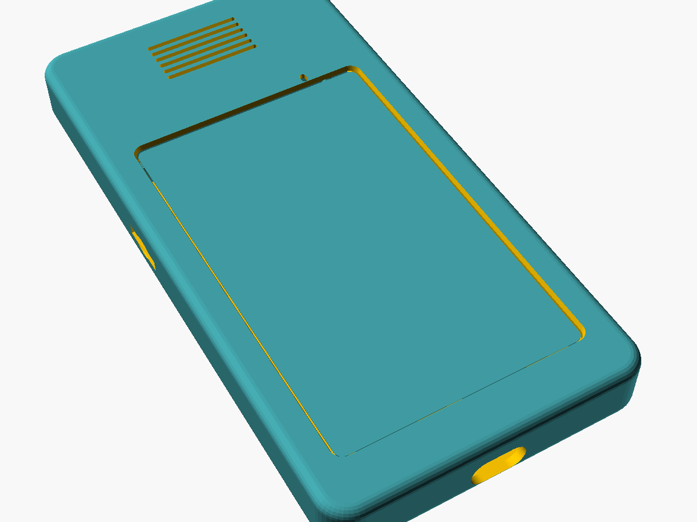
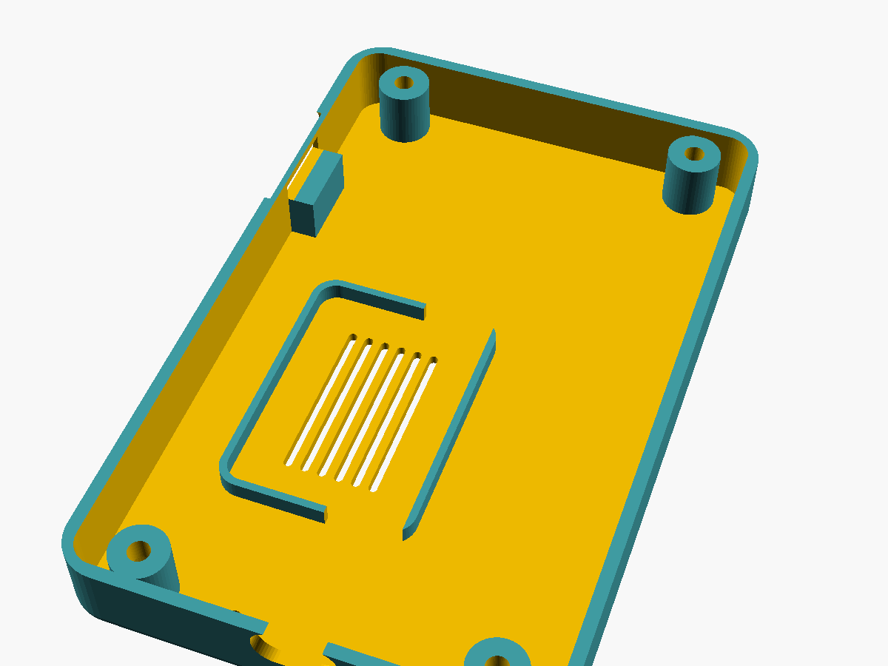

# Atlas S3 phone-style case

*Experimental, not yet printed.* A flat, rounded case for the 4-inch LCDWIKI
ES3C40P Atlas board in portrait, about **74.8 × 117.6 × 19.1 mm**.
Source: [`atlas_s3_phone_case.scad`](atlas_s3_phone_case.scad) (OpenSCAD 2021.01 or newer).



| Part | File | Print |
|---|---|---|
| Tub: back, walls, standoffs | [`atlas_s3_tub.stl`](atlas_s3_tub.stl) | Back face down, no supports |
| Bezel: front frame and window | [`atlas_s3_bezel.stl`](atlas_s3_bezel.stl) | Front face down, no supports (already flipped) |



Hardware: four **M3 × 10** screws from the back. They pass through the tub
standoffs and the board's own holes, then self-tap into the bezel bosses
(pilot 2.5 mm). The heads sit in deep counterbores in the standoffs. For M3 × 5.7 heat-set inserts, set `screw_pilot = 4.0`.

## Layout

Looking at the screen, the microphone end is the top and USB-C is at the
bottom, like a phone. The vendor drawing places the mic hole and the
back-side mic part at the same corner, which confirms that orientation. If
the UI draws upside down in the case, flip `LCD_ROTATION` in
`Atlas/include/config.h` instead of the case.

- **USB-C:** a 13 × 7 mm slot at the bottom, centred on the receptacle.
- **microSD:** a slot on the left side (looking at the screen) with a
  fingertip recess. A shelf guides the card across the side gutter. The card
  sits about 6 mm in, so push it home with a fingernail or a coin edge.
- **Microphone:** a 1.6 × 2.6 mm port in the bezel, above the window.
- **BOOT / RESET:** 2.2 mm paper-clip holes in the back near the bottom
  corners. Uploads over USB don't need them.
- **Edge connectors (battery, speaker, UART, I²C, expansion):** they all face
  the board's long edges, so the tub has a 4.5 mm gutter down each side for
  the plugs. Wires turn under the board into the back cavity.
- **Speaker:** the board kit's oval speaker (40.1 × 28.3 × 9.7 mm, measured)
  lies face down on the back plate in a cradle, firing through seven slots.
  It sits in the component-free area below the display connector, pushed
  into the right-hand gutter (looking at the screen), so its 50 mm lead
  reaches the 2-pin socket on that edge. That is why the cavity behind the
  board is 10 mm deep instead of the 5.5 mm the components need. Stick small
  rubber feet on the back corners so the grille isn't muffled on a table.
- **Battery:** no room yet; it would need more depth again.

## Measurements and fit risks

Board numbers come from the [ES3C40P Specification V1.0][spec], figure 5.1
(PCB 61.04 × 112.21 × 1.6 mm, R3.5 corners, Ø3.2 holes at 53.04 × 104.21 mm,
4 mm from the edges, 11.45 mm overall). Ricky's calipers agree:
112.2 × 61.0 mm, 104.0 / 53.1 mm across the holes and 10.1 mm thick.

The drawing and the photos disagree on where the cover glass sits along the
board: the drawing says 94.57 mm long and 9.0 mm from the mic end, while the
photos look closer to 98 mm and 6 mm. The bezel tolerates both. The window
(58 × 94.2 mm) always clears the active area, the pocket under the lip takes
the whole board, and the screw bosses are clipped 5.6 mm from each end
(`boss_clip`). Check these on the first print:

1. The glass sits clear of the bezel bosses at the mic end.
2. The mic port lines up with the hole on the board (6.04 mm from the top,
   14.13 mm from the right edge in the drawing).
3. Your USB-C plug's moulding fits the slot.

Every opening and clearance is a named parameter at the top of the `.scad` file.
To regenerate the STLs:

```
openscad -D 'part="tub"'   -o atlas_s3_tub.stl   atlas_s3_phone_case.scad
openscad -D 'part="bezel"' -o atlas_s3_bezel.stl atlas_s3_phone_case.scad
```

[spec]: https://www.lcdwiki.com/res/ES3C40P/ES3C40P_Specification_V1.0.pdf
