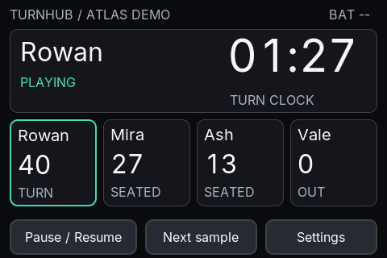
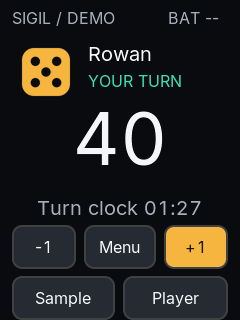

# LVGL milestone previews — 2026-10-11

Actual SDL software-renderer captures from the isolated [desktop simulator](../../../../LVGL/README.md), implementation commit `2857474d2e2f0e3c39f43fbc437d5be36542600a`. These are deterministic fixture screens, not photographs or physical panel acceptance.

Environment: Debian 13, GCC 14.2.0, Release build, LVGL 9.3.0 and SDL 2.32.4 built from pinned official source archives. SDL used the X11 backend under Xvfb (`DISPLAY=:99`); logical pixels were captured at zoom 1. No hardware, phone or server was connected. The later generated-font whitespace normalization does not change glyph data.

```sh
DISPLAY=:99 python3 LVGL/tests/capture_matrix.py \
  --executable LVGL/build-source/bin/turnhub_sim \
  --output Documentation/engineering/history/2026-10-11-lvgl-previews --driver x11
```

Start an X11 desktop or Xvfb before this command. Normal build and launch instructions are in the simulator README; `build-source` is this session's local build directory.

All **14 captures passed** exact resolution, shared-token background, nonblank-pixel and distinct-scene checks. [captures.json](captures.json) records RGBA pixel SHA256 values. Both profile input suites also passed through X11; Debug/Release CTest and ASan/UBSan evidence is recorded in the simulator README. Selected Graphite, Brass, Daylight and pairing images were visually reviewed. This is not OCR, golden-image comparison, physical readability testing or Windows validation.

| Screen | Atlas 480 × 320 | Sigil 240 × 320 |
|---|---|---|
| Graphite gameplay | [PNG](atlas-graphite-game-0.png) | [PNG](sigil-graphite-game-0.png) |
| Daylight gameplay | [PNG](atlas-daylight-game-0.png) | [PNG](sigil-daylight-game-0.png) |
| Brass gameplay | [PNG](atlas-brass-game-0.png) | [PNG](sigil-brass-game-0.png) |
| High Contrast gameplay | [PNG](atlas-contrast-game-0.png) | [PNG](sigil-contrast-game-0.png) |
| Mock pairing | [PNG](atlas-graphite-pairing-0.png) | [PNG](sigil-graphite-pairing-0.png) |
| Paused | [PNG](atlas-graphite-game-2.png) | [PNG](sigil-graphite-game-2.png) |
| Game over | [PNG](atlas-graphite-game-3.png) | [PNG](sigil-graphite-game-3.png) |




