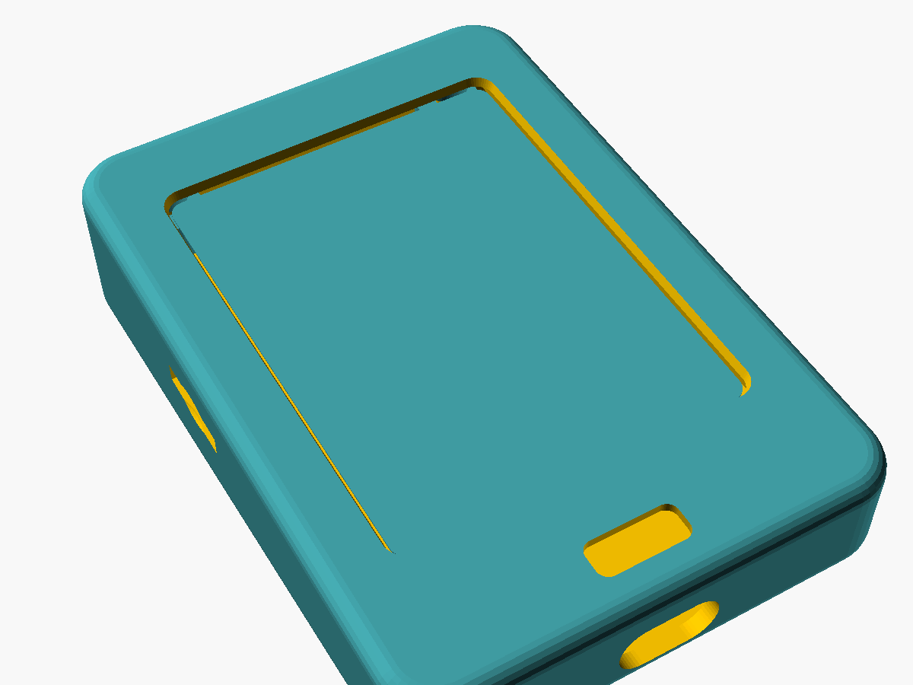

# Sigil stand-in case: E32R28T phone style

*Experimental, not yet printed.* A portrait, rounded case for the 2.8-inch
LCDWIKI E32R28T board (the old Gen 1 Atlas board, now standing in for a
Sigil), in the same style as the
[Atlas S3 case](../../../Atlas/enclosure/s3_phone_case/README.md). It measures
**63.8 × 91.4 mm**: 14.4 mm thick when flat, or a 5° wedge from 14.4 mm at the
bottom to 22.4 mm at the top, which tips the screen toward the player.
Source: [`sigil_e32r28t_case.scad`](sigil_e32r28t_case.scad).



| Part | File | Print |
|---|---|---|
| Tub, flat | [`sigil_e32r28t_tub_flat.stl`](sigil_e32r28t_tub_flat.stl) | Back face down, no supports |
| Tub, 5° wedge | [`sigil_e32r28t_tub_tilt5.stl`](sigil_e32r28t_tub_tilt5.stl) | Already rotated so the wedge lies flat |
| Bezel (fits both) | [`sigil_e32r28t_bezel.stl`](sigil_e32r28t_bezel.stl) | Front face down (already flipped) |

Print one tub and the bezel. Hardware: four **M3 × 10** screws from the back,
through the standoffs and the board's holes, self-tapping into the bezel
(pilot 2.5 mm; `screw_pilot = 4.0` for heat-set inserts).

## Layout

USB-C is at the bottom and the screen is portrait. If the picture runs the
wrong way round, change the display rotation in firmware, not the case.

- **Display:** a 46 × 60.6 mm window over the touch area. The lip sits 0.4 mm
  above the resistive touch film so it can never press a phantom touch.
- **Light window:** a 12 × 5 mm opening below the screen over the small
  front parts on the board's bottom strip (*Needs verification*: their
  function isn't labelled on the drawing).
- **microSD:** a slot on the left side with a fingertip recess and a guide
  shelf; the card sits about 6 mm in.
- **RESET / BOOT:** paper-clip holes in the back near the bottom.
- **Edge connectors (speaker, SPI, UART, battery):** a 4.5 mm gutter down each
  side leaves room for the plugs.
- **Angle:** set `tilt` (degrees) and re-export the tub; the bezel stays the same.

## Measurements

From the [E32R28T outline drawing][size] (V1.0, 2024-08-31): PCB 50 × 86 ×
1.6 mm, R3.5 corners, Ø3.2 holes 4 mm in from the edges (42 × 78 apart),
4.0 mm of display and touch above the PCB, back parts up to 5.09 mm. Not yet
checked with calipers on the board.

```
openscad -D 'part="tub"'             -o sigil_e32r28t_tub_flat.stl  sigil_e32r28t_case.scad
openscad -D 'part="tub"' -D tilt=5   -o sigil_e32r28t_tub_tilt5.stl sigil_e32r28t_case.scad
openscad -D 'part="bezel"'           -o sigil_e32r28t_bezel.stl     sigil_e32r28t_case.scad
```

[size]: https://www.lcdwiki.com/res/E32R28T/E32R28T_Size.pdf
