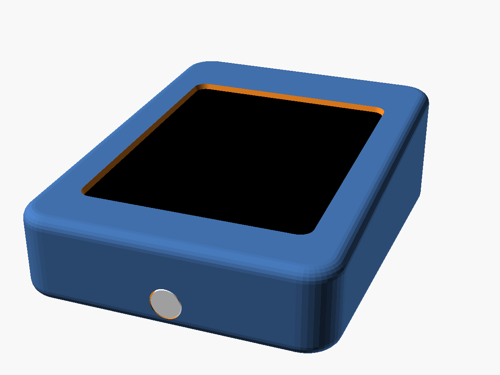
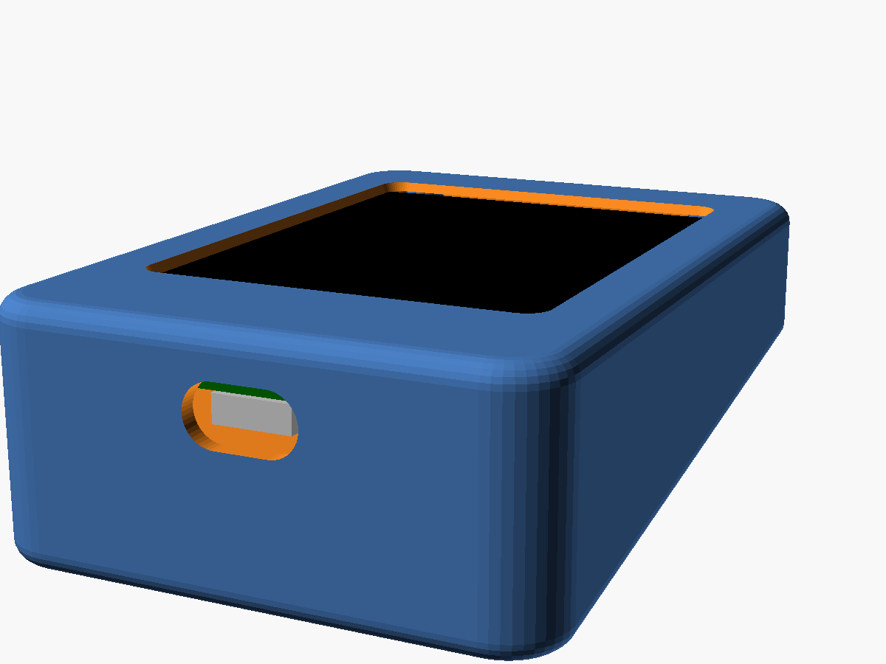
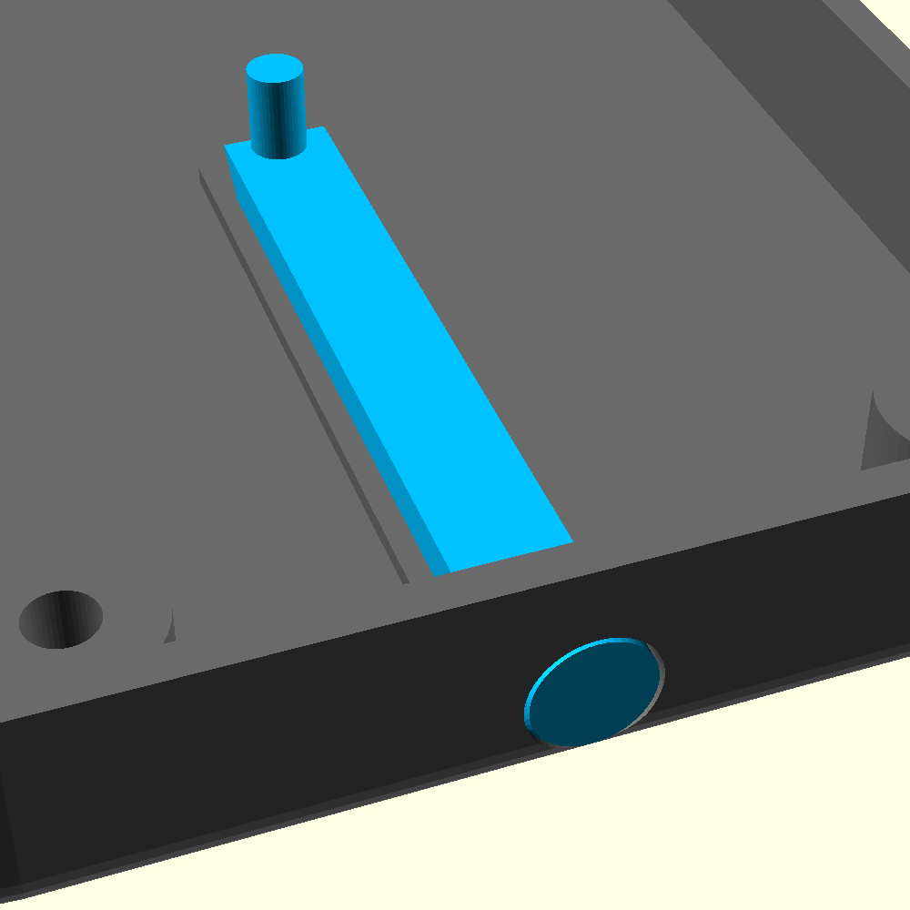

# Sigil stand-in case: E32R28T phone style

*Experimental, not yet printed.* A portrait, rounded case for the 2.8-inch
LCDWIKI E32R28T board (the old Gen 1 Atlas board, now standing in for a
Sigil), in the same style as the
[Atlas S3 case](../../../Atlas/enclosure/s3_phone_case/README.md). It measures
**63.8 × 91.4 mm**: 17.4 mm thick when flat, or an 8° wedge from 17.4 mm at the
front to 30.2 mm at the back (the USB-C end), which tips the screen toward the
player.
Source: [`sigil_e32r28t_case.scad`](sigil_e32r28t_case.scad).





| Part | File | Print |
|---|---|---|
| Tub, flat | [`sigil_e32r28t_tub_flat.stl`](sigil_e32r28t_tub_flat.stl) | Back face down, no supports |
| Tub, 8° wedge | [`sigil_e32r28t_tub_tilt8.stl`](sigil_e32r28t_tub_tilt8.stl) | Already rotated so the wedge lies flat |
| Bezel (fits both) | [`sigil_e32r28t_bezel.stl`](sigil_e32r28t_bezel.stl) | Front face down (already flipped) |
| Light bar (fits both) | [`sigil_e32r28t_light_bar.stl`](sigil_e32r28t_light_bar.stl) | Clear PETG or PLA, on its side (already rotated), 100% infill |

Print one tub and the bezel. Hardware: four **M3 × 10** screws from the back,
through the standoffs and the board's holes, self-tapping into the bezel
(pilot 2.5 mm; `screw_pilot = 4.0` for heat-set inserts).



## Layout

The screen is portrait and USB-C faces away from the player, so the cable
leaves from the back of the table. The firmware keeps the panel's own
rotation (the owner checked it reads right, 2026-10-29). If the picture runs
the wrong way round, change `setRotation` in
`Sigil/src/sigil_board_e32r28t.cpp`, not the case.

- **Display:** a 46 × 60.6 mm window over the touch area. The lip sits 0.4 mm
  above the resistive touch film so it can never press a phantom touch.
- **Status light:** the board's only RGB LED faces the back, so a clear light
  bar carries it to a round 6 mm lens flush in the front wall, facing the
  player. The 6 × 2.6 mm bar lies on the tub floor between two low rails; a
  post rises to 1 mm below the LED and a 45° face under it turns the light
  toward the front. Past the board's end the bar swells into the lens. The
  back cavity is 3.5 mm deeper than the board needs to make room for it. Fit
  the lens into its hole first, then lay the bar between the rails. The LED position (about
  mid-width, 41.5 mm from the USB end) comes from a photo
  (*Needs verification*); move `led_c` if the post misses it.
- **microSD:** no slot (removed 2026-10-29: behind the plug gutter the card
  sat 7.5 mm in and could not be swapped). The Sigil doesn't need a card.
- **RESET / BOOT:** paper-clip holes in the back near the USB-C end.
- **Edge connectors (speaker, SPI, UART, battery):** a 4.5 mm gutter down each
  side leaves room for the plugs.
- **Angle:** set `tilt` (degrees) and re-export the tub; the bezel stays the same.

## Measurements

From the [E32R28T outline drawing][size] (V1.0, 2024-08-31): PCB 50 × 86 ×
1.6 mm, R3.5 corners, Ø3.2 holes 4 mm in from the edges (42 × 78 apart),
4.0 mm of display and touch above the PCB, back parts up to 5.09 mm. Not yet
checked with calipers on the board.

```
openscad -D 'part="tub"'             -o sigil_e32r28t_tub_flat.stl  sigil_e32r28t_case.scad
openscad -D 'part="tub"' -D tilt=8   -o sigil_e32r28t_tub_tilt8.stl sigil_e32r28t_case.scad
openscad -D 'part="bezel"'           -o sigil_e32r28t_bezel.stl     sigil_e32r28t_case.scad
openscad -D 'part="pipe"'            -o sigil_e32r28t_light_bar.stl sigil_e32r28t_case.scad
```

[size]: https://www.lcdwiki.com/res/E32R28T/E32R28T_Size.pdf
